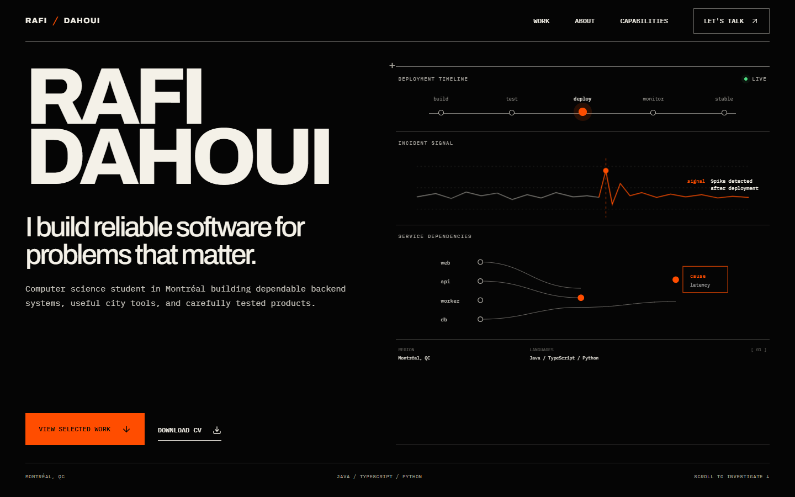

# Rafi Dahoui — Portfolio

A responsive, single-page portfolio built with React, TypeScript, and Vite. The visual direction is an operational editorial system: high-contrast typography, technical interface details, restrained safety orange, and motion that respects reduced-motion preferences.



Archivo Variable and IBM Plex Mono are bundled locally, so the site does not depend on a third-party font service.

## Run locally

```powershell
npm install
npm run dev
```

Open the local URL printed by Vite.

## Production build

```powershell
npm run build
npm run preview
```

The deployable static site is generated in `dist/`. It can be hosted on Vercel, Netlify, Cloudflare Pages, or GitHub Pages. Use `npm run build` as the build command and `dist` as the output directory.

## Where to edit

- Portfolio copy and project facts: `src/data.ts`
- Page composition: `src/App.tsx`
- Individual sections: `src/components/`
- Visual system, animations, and responsive layout: `src/styles-v2.css`
- Downloadable résumé: `public/Rafi-Dahoui-CV.pdf`

## Publishing notes

The site is production-build ready. When a domain is chosen, add its absolute URL and social-preview image to the Open Graph metadata. Live demo links or real product screenshots can be added later without changing the current case-study structure.
